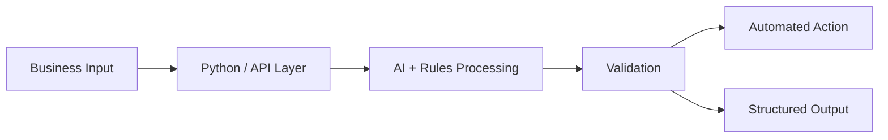

<!-- GitHub Profile README | Anisursaadi | Premium AI Engineering Edition -->

  

<h1 align="center">Anisur Rahman Shakshadi</h1>

  <strong>AI Automation Engineer</strong> 
  Python &bull; AI Agents &bull; LLM Integrations &bull; APIs &bull; Data Pipelines

  I design and build AI-powered workflows that connect intelligent models, 
  reliable software, structured data, and real business operations.

  
  
  

---

## 👨‍💻 About

I work at the intersection of **AI, Python engineering, API integration, and business process automation**. My focus is turning repetitive or data-heavy operations into maintainable systems with clear inputs, reliable processing, and useful outputs.

I care about **data quality, validation, error handling, and practical deployment**—not just AI features that look impressive in a demo.

## ⚡ Engineering Focus

<table>
  <tr>
    <td width="50%" valign="top">
      <h3>🤖 AI Agents & LLM Systems</h3>
      
Tool-enabled AI workflows, structured model outputs, business-rule checks, and API-connected applications.

    </td>
    <td width="50%" valign="top">
      <h3>🐍 Python Automation</h3>
      
Repeatable backend processes, scheduled jobs, browser workflows, and integrations that reduce manual effort.

    </td>
  </tr>
  <tr>
    <td width="50%" valign="top">
      <h3>📊 Data Engineering & Quality</h3>
      
ETL, normalization, validation, document processing, enrichment, and clean structured datasets.

    </td>
    <td width="50%" valign="top">
      <h3>🔗 APIs & Business Systems</h3>
      
REST APIs, webhooks, data synchronization, e-commerce operations, and service-to-service workflows.

    </td>
  </tr>
</table>

## 🧰 Technologies & Tools

  

  
  
  
  
  
  
  

## 🧠 How I Structure AI Automation

An illustrative architecture for connecting inputs, models, validation, and downstream actions:

**Engineering priorities:** predictable behavior · validation before action · useful logs · recoverable failures · maintainable integrations.

## 🏗️ Systems I Focus On

| Area | Typical engineering problems |
| :--- | :--- |
| **AI & agentic workflows** | Tool calling, structured outputs, multi-step orchestration, human review |
| **Python automation** | Repetitive processes, scheduled tasks, workflow coordination |
| **Data pipelines** | Extraction, cleanup, transformation, deduplication, validation |
| **Document processing** | Unstructured content to usable JSON, CSV, or spreadsheets |
| **API integration** | Connecting internal tools, third-party services, and AI models |
| **E-commerce operations** | Product data QA, catalog workflows, and system synchronization |

<!--
FEATURED PROJECTS: Activate this section after public demonstration repositories exist.
Replace example repository paths with real published projects before removing this comment.

## 🚀 Featured Projects

| Project | What it demonstrates |
| :--- | :--- |
| [AI Agent Workflow](https://github.com/Anisursaadi/REPLACE-WITH-REAL-REPOSITORY) | LLM orchestration, tool use, and output validation |
| [Data Quality Pipeline](https://github.com/Anisursaadi/REPLACE-WITH-REAL-REPOSITORY) | Python ETL, validation, and structured outputs |
-->

---

## 🚀 Featured Project

### 🤖 [AI Agent Workflow System](https://github.com/Anisursaadi/ai-agent-workflow-system)

**Python • OpenAI Responses API • Function Calling • Workflow Automation**

An auditable AI agent demonstration featuring tool-enabled workflows, policy validation, structured business data, and human oversight.

### Key Features

- 🤖 **AI Tool Calling:** Optional OpenAI integration with controlled tool execution.
- 🛡️ **Policy Validation:** Rule-based checks for business decisions.
- 🔒 **Human Oversight:** Sensitive actions require human review.
- ⚙️ **Offline Mode:** Run the demonstration without an API key.
- 🧪 **Automated Testing:** Reproducible tests with GitHub Actions.
- 🌐 **REST API:** Local endpoints for workflow evaluation.

**[Explore Source Code & Documentation](https://github.com/Anisursaadi/ai-agent-workflow-system)**

---

## 🤝 Let's Connect

Interested in **AI automation, Python development, LLM integrations, data workflows, or APIs**? I'm open to discussing freelance and contract projects.

  <a href="https://www.upwork.com/freelancers/ashakshadi"><strong>Upwork Portfolio</strong></a>
  &nbsp;&nbsp;&bull;&nbsp;&nbsp;
  <a href="https://www.linkedin.com/in/anisurshakshadi/"><strong>LinkedIn</strong></a>
  &nbsp;&nbsp;&bull;&nbsp;&nbsp;
  <a href="https://github.com/Anisursaadi?tab=repositories"><strong>GitHub Projects</strong></a>

<strong>Building dependable AI automation for real-world operations.</strong>

  

